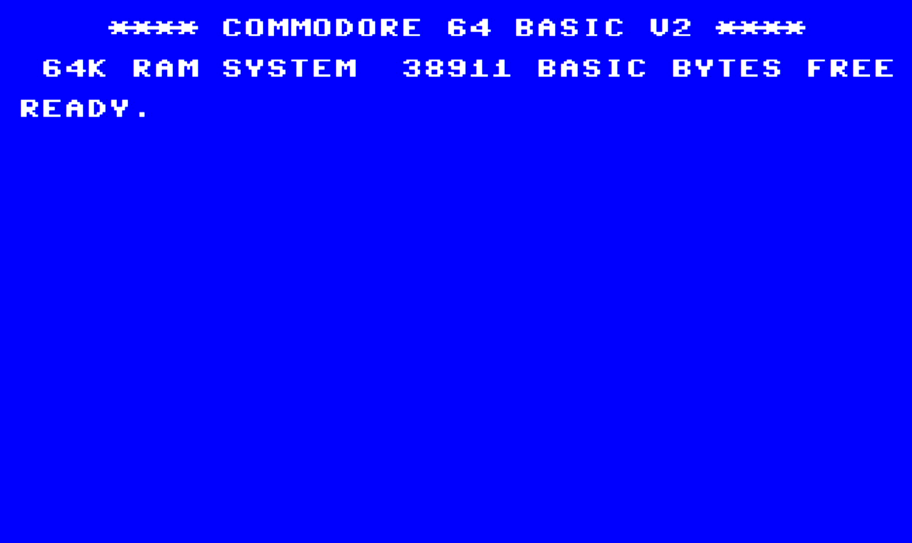
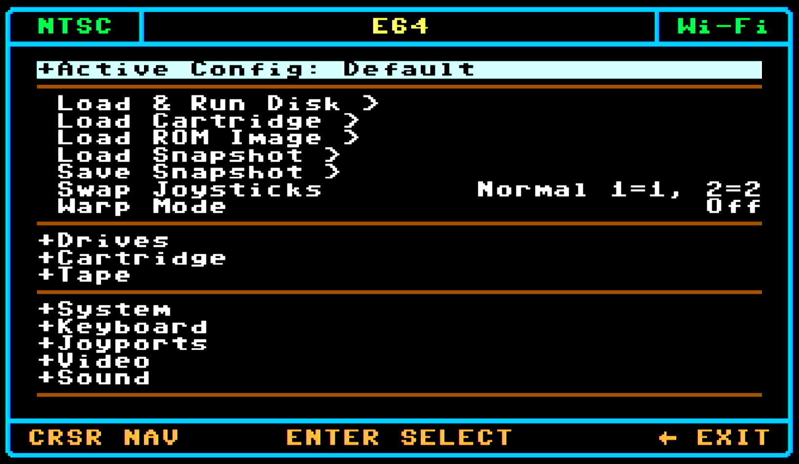
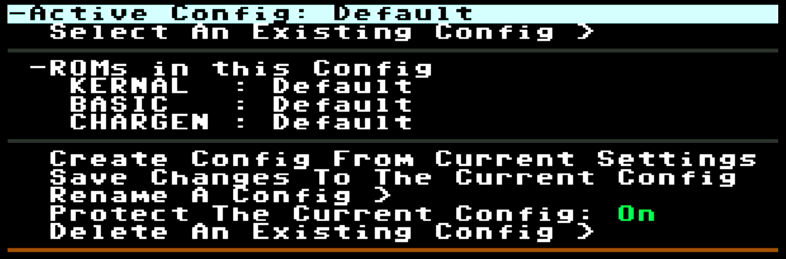
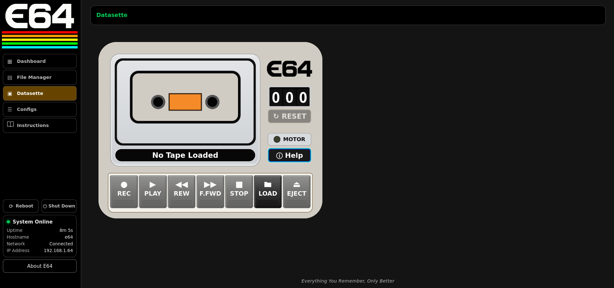
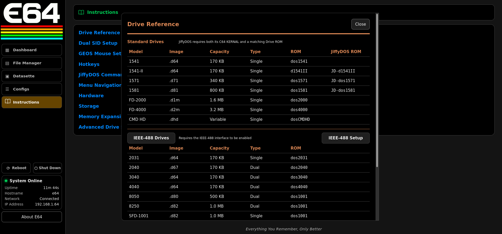
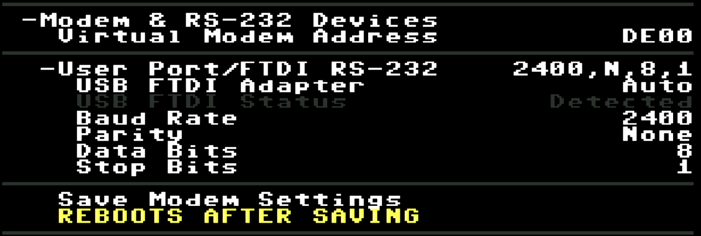
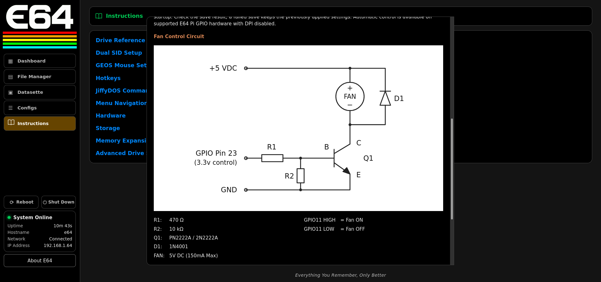
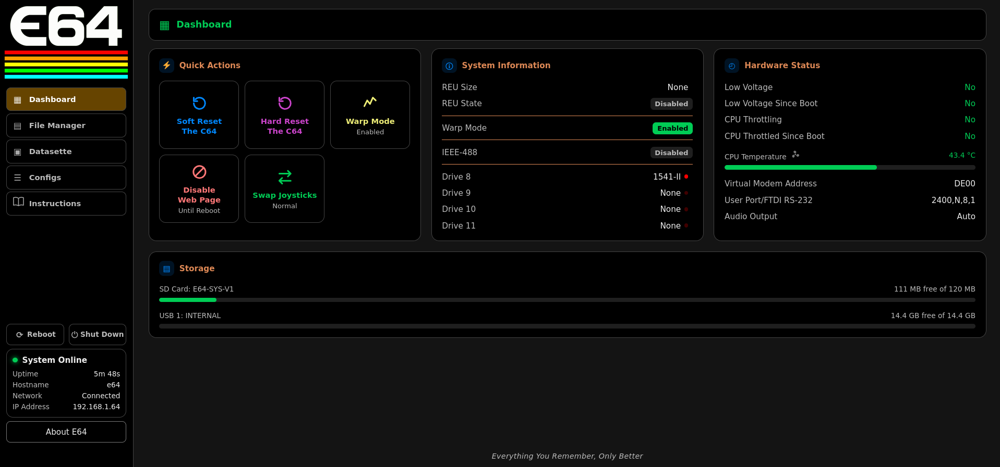

# E64

E64 (Enhanced 64) V1 is a bare-metal Commodore 64 emulator for the Raspberry Pi 3B+.
It is derived from upstream BMC64 5.2.6 and uses VICE and Circle.

Read the [SD card guide](sdcard/README.txt) for the current lowercase FAT32
layout, ROM directories, Configs and Main save-recovery paths. Each SD
directory has its own plain-text README.

The protected internal Main Config is displayed as Default Configuration.
Custom Config names allow 32 UTF-8 bytes.

E64 V1 is publicly released for independent community development. The project is provided as-is, without any
commitment to future updates, maintenance or technical support.

The public-release kernel has passed compilation and host regression
checks. Full hardware verification of the published firmware remains outstanding.

Commodore system ROMs, drive ROMs and proprietary cartridge ROMs
must be obtained separately by the user.

For a complete Raspberry Pi 3 C64 build, run `bash make_all.sh pi3`.
For an incremental kernel build after dependencies have been built,
run `BOARD=pi3 make -f Makefile-C64`.
See the [documentation index](docs/README.md) for source and review guides.

The [original upstream README](docs/upstream/README-BMC64.md) is preserved
unchanged, including upstream project links, community information and
historical release descriptions. Those releases describe upstream BMC64.
See [LICENSE](LICENSE) and [third-party attribution](docs/THIRD_PARTY.md).

## E64 V1 automatic fan (HDMI installation)

Automatic fan control uses BCM GPIO11 (physical header pin 23). GPIO/DPI video output is not supported while this fan connection is in use.

E64 V1 refuses DPI selections before updating boot files and refuses DPI startup before assigning GPIO pins. Other targets retain their DPI source path. Use HDMI boot configuration; firmware overlays or external SPI hardware must not assign GPIO11.

System > Automatic Fan provides Disabled/Enabled (default Disabled), Fan ON Temperature (55°C) and Fan OFF Temperature (50°C). Both thresholds use whole degrees, 30–80°C, with OFF strictly below ON. Changes are submitted to the hardware service; Save Status reports Pending, Saved or Save Failed. Web Dashboard controls use the same global settings, independent of C64 Config. No preferences are written by temperature polling.

The controller polls about once per second on the service core, keeps its previous output between thresholds, and commands ON for a failed or implausible temperature reading while enabled. This does not change Pi thermal limits or emulator clocks. The Dashboard fan icon is green for commanded GPIO ON, gray for enabled/OFF, and hidden when disabled or unavailable. No tachometer or physical rotation feedback is provided.

GPIO11 is a 3.3V control signal for an external active-high transistor circuit, never a motor supply. Provide an appropriate transistor, flyback protection, common ground and an external gate/base pulldown so boot/reset does not float ON. Software starts the output LOW, then loads /system/fan-prefs.txt through the global SD preference mechanism. On orderly shutdown/reboot it retains cooling ON if enabled until reset or power removal; a halted Pi can leave the fan running. Firmware/reset behavior before the application runs requires electrical verification. No SPI0 peripheral may share this pin.

Source checks (host tests only): `python3 tools/fan_test/run_tests.py`, `python3 tools/fan_test/prefs_disk_test.py`, and `node tools/fan_test/web_test.mjs` (Node 22.12+). The first includes comparison with the timestamped pre-edit source checkpoint. `python3 tools/fan_test/arm_syntax_check.py` runs ARM parsing only with the installed cross-toolchain; it does not produce objects or firmware.

## Community Handoff

E64 V1 represents the conclusion of active development by its
original E64 developer.

The community is encouraged to fork, improve and independently
maintain E64 under the applicable software licenses.

No future updates, technical support or maintenance are promised.

- [Public GitHub repository](https://github.com/E64-Project/E64)
- [Firmware releases](https://github.com/E64-Project/E64/releases)
- [Build instructions](docs/BUILDING.md)
- [Community development](docs/CONTRIBUTING.md)
- [Project scope](docs/SCOPE.md)

---

## E64 V1 Screenshots

A look at Enhanced 64 running on the Raspberry Pi 3B+.

<table>
<tr>
<td align="center">
<strong>Commodore 64</strong> 

</td>
<td align="center">
<strong>Main Menu</strong> 

</td>
<td align="center">
<strong>Configurations</strong> 

</td>
</tr>
<tr>
<td align="center">
<strong>File Manager</strong> 

</td>
<td align="center">
<strong>Datasette</strong> 

</td>
<td align="center">
<strong>Drive Reference</strong> 

</td>
</tr>
<tr>
<td align="center">
<strong>Modems &amp; RS-232</strong> 

</td>
<td align="center">
<strong>Fan Control Help</strong> 

</td>
<td align="center">
<strong>Web Dashboard</strong> 

</td>
</tr>
</table>
